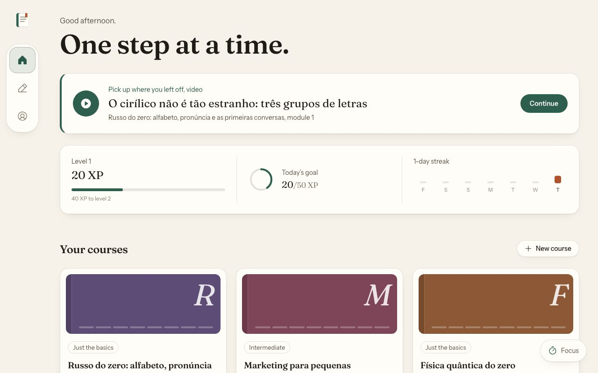
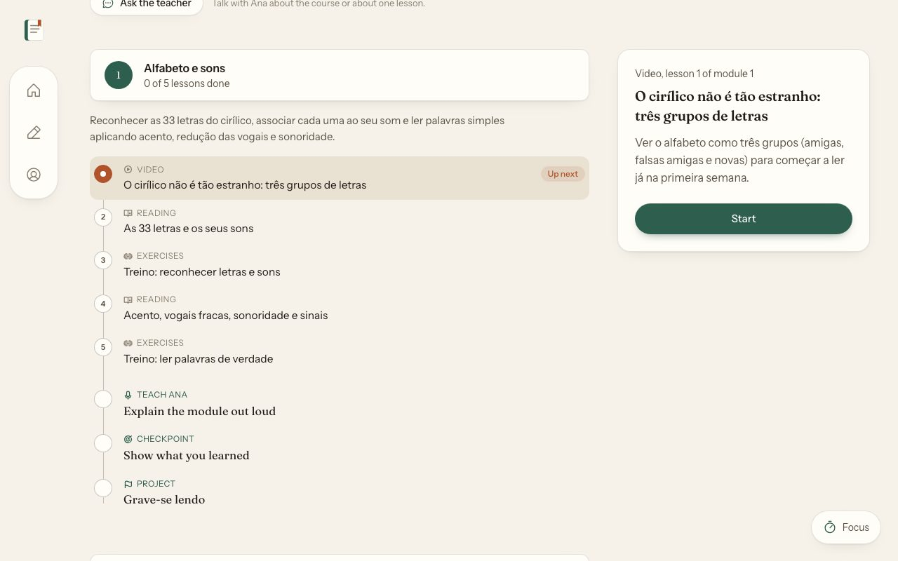
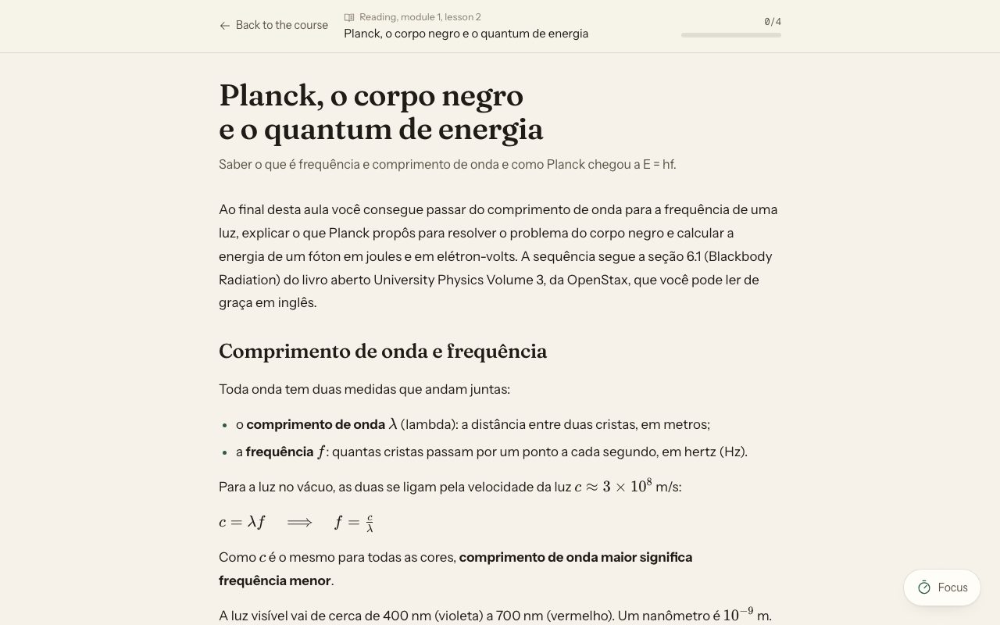
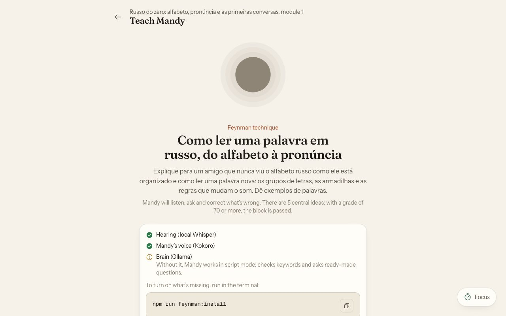
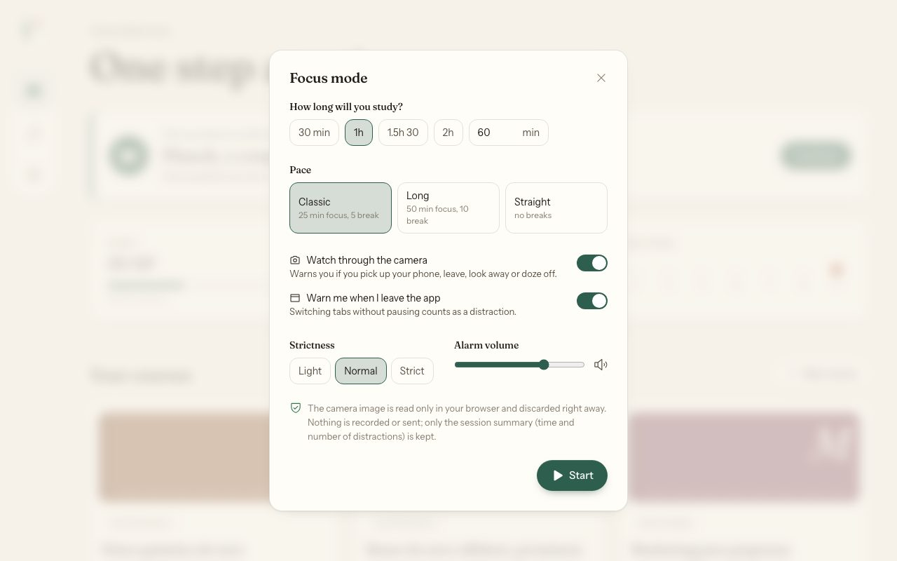

# Learning Anything

[](https://github.com/pedromzn/Learning_Anything/actions/workflows/ci.yml)
[](https://github.com/pedromzn/Learning_Anything/actions/workflows/codeql.yml)
[](LICENSE)

Learn any subject with a course custom-made by **your** AI, studied in an app that runs only on your machine.

You say what you want to learn. Your AI (Claude Code, Codex, Cursor or another) researches the subject on the web and
**writes the course as JSON files** in `courses/<slug>/`. The local app shows the path, the text lessons, the exercises
(graded by the app itself), the narrated videos with pauses for questions, the checkpoint of each module, XP, streaks,
achievements and the certificate. The app **does not call any AI API**, and the video narration is generated on your
machine.



| The course path                                                               | A text lesson                                        |
| ----------------------------------------------------------------------------- | ---------------------------------------------------- |
|  |  |
| **Teach Mandy** (Feynman technique)                                           | **Focus mode** (pomodoro with webcam)                |
|   |        |

## Requirements

- **Node.js 24 LTS** (recommended; 22.13 or newer works)
- **ffmpeg** on the PATH (to generate videos and for the Feynman lesson to hear you): `brew install ffmpeg` (macOS),
  `sudo apt install ffmpeg` (Debian/Ubuntu), `winget install Gyan.FFmpeg` (Windows)
- An AI with access to this repository, to create courses (Claude Code, Codex, Cursor…)
- For the video voice: [**uv**](https://docs.astral.sh/uv/) (`brew install uv`, `winget install astral-sh.uv` or
  `curl -LsSf https://astral.sh/uv/install.sh | sh`) or Python 3.10+; `npm run voice:install` takes care of the rest
- Optional, for Mandy to really talk in the Feynman lesson: [Ollama](https://ollama.com/download)

Don't want to install by hand? Ask your AI: _"set up my machine for Learning Anything"_. It follows the
[`setup-machine`](.claude/skills/setup-machine/SKILL.md) skill, checks what you have and asks before downloading.

## Quick start

```bash
git clone https://github.com/pedromzn/Learning_Anything.git
cd Learning_Anything
npm install
npm run setup   # checks the machine and asks what to install (voice, Whisper, focus mode)
npm run dev
```

Open **http://localhost:3040**. Three sample courses come with module 1 ready (Quantum physics, Basic Russian and
Marketing for small businesses, all written in Brazilian Portuguese) so you can see how it works.

## Create a course with your AI

There are three ways. In all of them, your AI does the research and the writing, following [`AGENTS.md`](AGENTS.md).

### 1. With the app's "New course" button

1. In the app, click **New course** and fill in the brief in short steps (topic, scope, level, what you already know,
   hours per week, format, the course language…).
2. The app saves the request in `requests/<slug>.json` and shows a **ready-made command**.
3. Paste the command into your AI, opened in this folder. The app's **Creating the course** page watches the folder and lists
   each file the AI saves, as it happens.

### 2. Directly in your AI

Open the repository in Claude Code, Codex or Cursor and ask, for example:

> I want a physics course, only classical mechanics, from scratch, for someone who finished high school a long time
> ago. I have 4 hours a week. Follow AGENTS.md: talk with me to build the brief, research on the web, write module 1
> and validate everything.

The AI asks the brief questions, one at a time, and follows the flow.

### 3. "Tell your AI to read this repository"

No setup at all: tell your AI _"read this repository's `AGENTS.md` and help me create a course about X"_. `AGENTS.md`
is the complete manual; the skills in `.claude/skills/` have the step by step of each role (researcher, architect,
writer, problem teacher, Feynman teacher, scriptwriter, reviewer).

Each course is written in its own language (`brief.language`: `en`, the default, or `pt-BR`); the narration, the
subtitles and Mandy follow it. The interface language is a separate choice, made the first time the app opens.

The course starts with **module 1**. When you reach a module that is not written yet, the app shows the command to ask
your AI to write the next one. You can also ask the AI to **answer questions** about a lesson: it reads the file and
explains like a private tutor, without giving away the answers to the exercises.

> AI makes mistakes. Every course goes through the schemas and through teaching rules (`npm run course:validate`), but
> check the facts, the math and the links, especially on subjects where a mistake is costly.

## The local voice

The video lessons are narrated by [**Kokoro**](https://github.com/thewh1teagle/kokoro-onnx) (Apache 2.0 license), a
neural voice that **runs on your machine, on the processor only**: it needs no graphics card and no API. It works on
macOS (Intel or Apple Silicon), Linux and Windows. On an ordinary processor, it generates speech about 3 times faster
than the speaking time.

```bash
npm run voice:install            # installs the engine in data/voice/ (once, ~400 MB)
npm run voice:test -- --play     # speaks a sentence and plays it
npm run course:video -- <slug>   # generates the course's videos
```

| Variable (`.env`) | Values                                                                                                                                   | Default                                                           |
| ----------------- | ---------------------------------------------------------------------------------------------------------------------------------------- | ----------------------------------------------------------------- |
| `VOICE`           | English: `af_heart`, `af_bella` (female), `am_michael`, `am_fenrir` (male); Portuguese: `pf_dora` (female), `pm_alex`, `pm_santa` (male) | the first voice of the course's language (`af_heart` / `pf_dora`) |
| `VOICE_SPEED`     | from `0.5` to `2`                                                                                                                        | `1`                                                               |
| `VOICE_ENGINE`    | `auto`, `kokoro`, `silence`                                                                                                              | `auto`                                                            |
| `VIDEO_QUALITY`   | `720p` (renders in half the time), `1080p`                                                                                               | `720p`                                                            |

A `VOICE` from another language is ignored for that course. Without the engine installed, the videos come out silent
with the right duration, and the player warns you.

## Teach Mandy (Feynman technique)

In every module, before the checkpoint, you **explain the central topic out loud** to Mandy, an AI with a voice that
listens, asks questions, asks for examples and corrects what is wrong. At the end comes the score (70 or more passes and
gives XP), point by point. All local:

- **Listening:** local Whisper (`faster-whisper`): your voice does not leave the computer and is not recorded.
- **Thinking:** an open model in [Ollama](https://ollama.com) (default `qwen3:8b` or `qwen3:4b`). Without Ollama, Mandy
  works in **script mode**: she checks for keywords and asks ready-made questions.
- **Speaking:** Kokoro, with the voice `af_heart` in English courses and `pf_dora` in Portuguese ones.

```bash
npm run feynman:install   # voice + Whisper + (if Ollama is running) the model
```

Without a microphone, you can type the explanation. Details in [`docs/FEYNMAN.md`](docs/FEYNMAN.md).

## Spaced review

Every exercise you get wrong — in a lesson or a checkpoint — comes back on the following days, at growing intervals
(1, 3, 7, 14, 30 days), until it sticks (the Leitner system). The home screen shows how many are due today; get one
right and it waits longer, miss it and it returns tomorrow. At most 15 a day, a little XP for each correct review.
Nothing to set up.

## Ask the teacher

Every course has an **Ask the teacher** page (button on the course page). There you talk with Mandy, the course teacher,
by voice or typing: about **the whole course** (what it covers, how the modules connect, what to study next) or about
**one lesson**, picked from a list. She answers only from the course material, in the course language, and in
exercises she gives hints, never the answer. With Ollama she explains in her own words; without it, she reads the part
of the course closest to your question and tells you where it came from. Nothing is stored. Same setup as the Feynman
lesson (`npm run feynman:install`).

## Focus mode

A pomodoro with an optional webcam watcher. With the **Focus** button (on every screen), you choose how long you will
study and the rhythm (25/5, 50/10 or straight through). During the focus blocks, if you pick up your phone, leave
without pausing, keep looking away, doze off or switch tabs, a nudge shows up on the screen with an alarm. The sessions
go to your profile (focused time, focus %, most common distractions). It gives no XP: XP is only for what is learning.

- **The camera is read only in the browser**, by [MediaPipe](https://ai.google.dev/edge/mediapipe/solutions/guide)
  (Apache 2.0). No image is recorded or sent; only the session summary is kept.
- The detector (~8 MB) is downloaded once, when you ask: with the app's button or with `npm run focus:install`.
- Without a camera, it works as a plain pomodoro. Details in [`docs/FOCUS.md`](docs/FOCUS.md).

## Community

The **Community** tab lists courses other people built and shared on this repository. **Install** downloads one,
checks it with the same rules as your own courses and puts it in _My courses_; the videos are generated on your machine
(`npm run course:video -- <slug>`).

To share one of yours, open the course and press **Share in the community**. The app shows exactly what goes (the
course files, without your progress, videos or the personal fields of the brief) and then:

- with the [GitHub CLI](https://cli.github.com) logged in (`gh auth login`), it forks the repository and opens the pull
  request for you;
- without it, it gives you the file and the GitHub upload page.

A GitHub Action validates every course pull request; a maintainer reviews the sources, the licenses and the quality and
merges it. After the merge, the catalog is rebuilt and the course shows up in everyone's Community tab. Details in
[`community/README.md`](community/README.md).

### By hand

A course is just JSON files, so it can be shared. `npm run course:export -- <slug>` packs it into one
`<slug>.course.json` file (only the course files: no videos, no progress from `data/`, no requests). Whoever receives
it installs it with `npm run course:import -- <file>` (`--as <new-slug>` to rename, `--force` to replace a course with
the same name) and generates the videos on their own machine with `npm run course:video -- <slug>`. The import checks
everything before writing: the format, the file names and the same validation as `course:validate`.

## Commands

| Command                                                              | Does                                                                                  |
| -------------------------------------------------------------------- | ------------------------------------------------------------------------------------- |
| `npm install`                                                        | installs the app                                                                      |
| `npm run setup [-- --check \| --all]`                                | checks the machine and installs the optional parts, asking first                      |
| `npm run dev`                                                        | starts the API and the app at http://localhost:3040                                   |
| `npm start`                                                          | build and local production server                                                     |
| `npm run course:status -- <slug>`                                    | says what exists, what is missing and the next file to write                          |
| `npm run course:validate -- <slug> [--module N]` or `-- --all`       | validates against the schemas and teaching rules; exits with 1 and lists the problems |
| `npm run course:video -- <slug> [--module N] [--lesson M] [--force]` | local voice, render and HLS of the video lessons                                      |
| `npm run course:schemas`                                             | writes the JSON Schema of each file to `docs/schemas/`                                |
| `npm run course:export -- <slug> [--out path]`                       | packs a valid course into one `<slug>.course.json` file (no videos, no progress)      |
| `npm run course:import -- <file> [--as <new-slug>] [--force]`        | checks a `.course.json` file and installs it in `courses/`                            |
| `npm run voice:install`                                              | installs the Kokoro voice engine in `data/voice/`                                     |
| `npm run voice:test`                                                 | speaks a sentence with the chosen engine and says which one it was                    |
| `npm run feynman:install`                                            | prepares the Feynman lesson: voice, local Whisper and the Ollama model                |
| `npm run focus:install`                                              | downloads the focus-mode detector to `data/focus/`                                    |
| `npm run community:check [-- <file>...]`                             | validates the community bundles (what the pull request check runs)                    |
| `npm run community:index [-- --out <file>]`                          | builds the community catalog (`index.json`) from the valid bundles                    |
| `npm run verify`                                                     | typecheck, tests and validation of every course                                       |

## Folder structure

```
learning-anything/
├── AGENTS.md           the AI's manual (CLAUDE.md and the Cursor rule point to it)
├── .claude/skills/     create-course, continue-course, generate-videos, answer-questions, setup-machine
├── .cursor/rules/      the same rule for Cursor
├── courses/<slug>/     THE CONTENT (the AI writes here)
│   ├── brief.json  dossier.json  syllabus.json
│   └── module-N/       lesson-M.json, feynman.json, checkpoint.json (and the generated videos)
├── requests/           requests from "New course" (generated, out of git)
├── data/               progress (SQLite), voice, Whisper, focus detector and cache (generated, out of git)
├── shared/             zod contracts and the API contract
├── server/             Express: API and reading the courses
├── web/                React 19 + Tailwind 4
├── render/             Remotion: the video scenes
├── scripts/            the course:*, voice:*, feynman:* and focus:* commands
├── community/courses/  community courses (<slug>.course.json), sent by pull request
├── test/fixtures/      a frozen copy of two sample courses for the tests
├── voice/              the local Python processes: Kokoro (voice) and Whisper (ear)
└── docs/               content guide (CONTENT.md), FEYNMAN.md, FOCUS.md, generated schemas
```

The format of each file is in [`docs/CONTENT.md`](docs/CONTENT.md).

## Privacy

- **Nothing leaves your machine.** The app listens only on `127.0.0.1` and sends no telemetry.
- Your progress (XP, answers, certificates) stays in `data/progress.sqlite`, out of git.
- The app calls no AI or voice API. What reaches the internet is **your AI**, when it researches the subject, under the
  rules of the tool you use. Avoid putting personal data in the brief.
- The only connections made by the project itself are optional downloads, always at your request and checked by
  sha256: the voice (`npm run voice:install`), the focus-mode detector (`npm run focus:install` or the app's button) and
  the Whisper and model for the Feynman lesson (`npm run feynman:install`). Ollama, if you use it, runs on your machine.
- In focus mode, the camera image is processed only in the browser and discarded; nothing is recorded or sent.
- The **Community** tab reads the public catalog from GitHub only when you open it, and **Install** downloads only the
  course you chose. Sharing sends a course only when you press the button, through your own `gh`; the app never holds a
  GitHub token. `COMMUNITY=off` in `.env` keeps the tab offline (it then lists `community/courses/` in your folder).

## Contributing

See [`CONTRIBUTING.md`](CONTRIBUTING.md). In short: run `npm run verify` before the pull request, keep Prettier
(`npm run format`) and, if you touch a schema in `shared/`, update `docs/CONTENT.md`. Courses go to the community
(the app's **Share in the community** button), with exact-link sources and declared licenses. Security problems:
[`SECURITY.md`](SECURITY.md). Everyone follows the [code of conduct](CODE_OF_CONDUCT.md).

## License

[MIT](LICENSE). The sample courses explain, in original words, what open sources teach, and cite those sources; their
material stays free where it is and follows their licenses.

---

## Em português

O **Learning Anything** deixa a sua própria IA (Claude Code, Codex, Cursor...) montar um curso sob medida sobre qualquer
assunto. Clone o repositório, abra na sua ferramenta de IA e peça para ela ler o [`AGENTS.md`](AGENTS.md). A IA pesquisa
o assunto na web e **escreve o curso como arquivos JSON** em `courses/<slug>/`. O app local (`npm run dev`,
http://localhost:3040) mostra a trilha, as aulas de texto, os exercícios corrigidos pelo app, os vídeos narrados com
pausas para perguntas, os checkpoints, XP, sequência e certificados.

- A interface existe em inglês e em português do Brasil (escolha na primeira vez que o app abre). Cada curso é escrito
  na língua da ficha (`brief.language`: `en` ou `pt-BR`); a narração, as legendas e a Mandy seguem essa língua.
- O app não chama nenhuma API de IA. A narração roda no processador com o Kokoro (Apache 2.0), com vozes em inglês e em
  português.
- Requisitos: Node >= 22.13, ffmpeg, uv ou Python 3.10+ para a voz (`npm run voice:install`) e, opcional, o Ollama. Ou
  peça à sua IA para "preparar a máquina": ela segue a skill `setup-machine`.
- Valide o que a IA escreve com `npm run course:validate -- <slug>`.
- Tudo fica na sua máquina; o servidor escuta só em `127.0.0.1`. Licença MIT.
